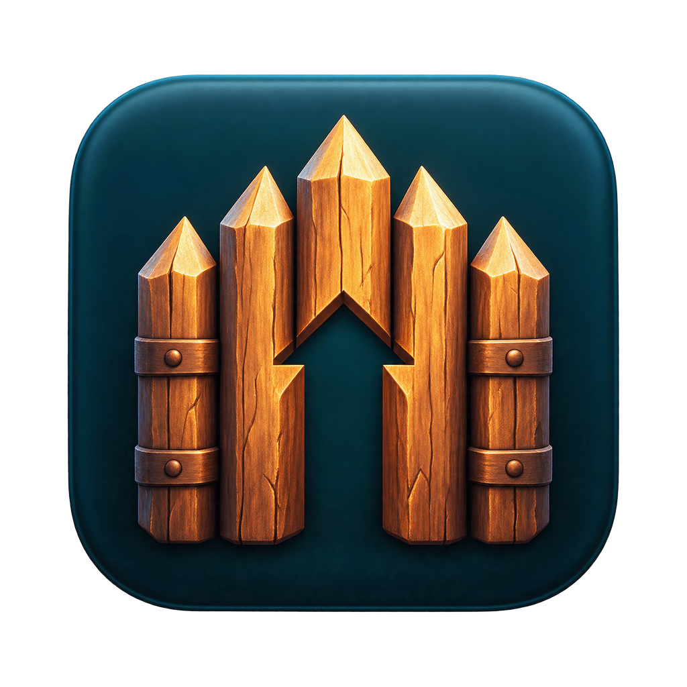

<p align="center">
  
</p>

<h1 align="center">Stockade</h1>

<p align="center"><strong>A native macOS launcher for the Windows Steam version of Farthest Frontier on Apple Silicon.</strong></p>

Stockade sets up one dedicated Wine prefix, runs Windows Steam inside it, and starts the
game you own, using Wine 11 and [DXMT](https://github.com/3Shain/dxmt) to translate
Direct3D 11 to Metal. It is a SwiftUI app plus a command-line tool, built on a tested core library.

> **Unofficial and experimental.** Not affiliated with Crate Entertainment or Valve.
> You need your own Steam copy of the game. Stockade does not bypass Steam or include any game,
> Steam, Wine or DXMT files.

**Status:** the main menu and gameplay work on an M3 Pro with macOS 26.5
(see [docs/compatibility-baseline.md](docs/compatibility-baseline.md)). A save/reload cycle and
a 30-minute stability test are still pending.

## How it works

```
Stockade.app / stockade-cli
        │  LaunchPlan (no shell, allowlisted environment, explicit WINEPREFIX)
        ▼
Wine 11.0 (Gcenx build) ─ rebuilt winemac.so (patch in runtime/patches)
        │
        ├─ Windows Steam ── steamwebhelper shim (--disable-gpu --single-process)
        └─ Farthest Frontier.exe ── DXMT d3d11/dxgi ── Metal
```

- **Truthful status.** "Game running" only appears once the prefix's own wineserver reports
  `Farthest Frontier.exe`. Otherwise you see "Launch requested — check Steam".
- **Scoped.** It only ever stops processes in its own prefix (`wineserver -k`), never other Wine apps.
- **Safe saves.** Backups are checksummed. A restore moves your current saves aside instead of
  deleting them.
- **Diagnostics.** Reports omit Steam login data, tokens, your environment and your user name.

## Requirements

- Apple Silicon Mac, macOS 14 or later (tested on macOS 26.5), Xcode 26
- Rosetta 2: `softwareupdate --install-rosetta`
- [Gcenx wine-stable 11.0_1](https://github.com/Gcenx/macOS_Wine_builds/releases/tag/11.0_1),
  unpacked to `/Applications/Wine Stable.app` (Homebrew's cask is currently disabled)
- [GStreamer runtime](https://gstreamer.freedesktop.org/download/) `.pkg`, needed for the game's videos
- Homebrew: `brew install bison flex gettext pkg-config mingw-w64`
- `SteamSetup.exe` from steampowered.com and a Steam account that owns the game

## Setup

```bash
git clone https://github.com/Frogleim/Stockade.git && cd Stockade

# 1. Build the Wine 11 + DXMT runtime (clones Wine 11.0, rebuilds one driver, ~1 minute)
runtime/build-dxmt-runtime.sh

# 2. Build Stockade and the Steam web-view shim
swift build
scripts/build-shim.sh
CLI=.build/debug/stockade-cli

# 3. Select the runtime and create the prefix
$CLI select-runtime "$HOME/Library/Application Support/io.github.frogleim.stockade/Runtimes/Wine 11.0 DXMT 0.80.app/Contents/Resources/wine/bin/wine"
$CLI create-prefix && $CLI init-prefix

# 4. DXMT's helper DLL inside the prefix
P="$HOME/Library/Application Support/io.github.frogleim.stockade/Prefixes/Farthest Frontier Prefix/drive_c/windows"
cp ~/Developer/wine-build/dxmt-v0.80/x/v0.80/x86_64-windows/winemetal.dll "$P/system32/"
cp ~/Developer/wine-build/dxmt-v0.80/x/v0.80/i386-windows/winemetal.dll "$P/syswow64/"

# 5. Windows Steam
$CLI install-steam ~/Downloads/SteamSetup.exe
$CLI steam-args -cef-disable-gpu -no-cef-sandbox -noverifyfiles
$CLI webhelper-shim "$PWD/Tools/steamwebhelper-shim/build/steamwebhelper-shim.exe"
$CLI open-steam        # sign in, then install Farthest Frontier from your library

# 6. Play
$CLI launch            # or open the app: scripts/build-app.sh && open dist/Stockade.app
```

If Steam's window keeps closing about 10 seconds after it starts, Wine's CoreAudio driver is
crashing Steam's web view. Turn off audio for Steam's own programs only (the game keeps its sound);
the exact registry keys are in [docs/compatibility-baseline.md](docs/compatibility-baseline.md#prefix).

## Command-line tool

| Command | Purpose |
| --- | --- |
| `status`, `ps`, `prefixes` | What is configured, what is running, which prefixes exist |
| `select-runtime`, `create-prefix`, `init-prefix`, `use-prefix`, `adopt-prefix` | Runtimes and prefixes (one prefix per runtime) |
| `install-steam`, `open-steam`, `steam-args`, `webhelper-shim` | Windows Steam |
| `plan`, `launch`, `game-args`, `shutdown-prefix --yes` | Launching |
| `diagnostics [file]`, `verbose on/off` | Troubleshooting |
| `set-saves`, `backup`, `backups`, `import-game` | Saves and game files |

## Project layout

| Path | Contents |
| --- | --- |
| `Stockade/` | SwiftUI app (Setup, Game, Settings, Diagnostics, Save Backups) |
| `Packages/LauncherCore/` | Core library and its tests (64 tests, no Wine or Steam needed) |
| `Tools/stockade-cli/` | Command-line tool over the same API |
| `Tools/steamwebhelper-shim/` | Small Windows program that fixes Steam's black window |
| `runtime/` | Runtime build script and the Wine patch |
| `docs/` | Architecture, compatibility baseline, benchmarks, regression checklist |
| `scripts/` | App packaging, shim build |

## Data locations

| What | Where |
| --- | --- |
| Configuration, prefixes, runtimes, backups | `~/Library/Application Support/io.github.frogleim.stockade/` |
| Logs (rotated, size-limited) | `~/Library/Logs/io.github.frogleim.stockade/` |

## Contributing

Bug reports with a diagnostics report (`stockade-cli diagnostics report.txt`, reviewed before
posting) are very welcome, as are results from other Macs for the compatibility baseline.
Run `cd Packages/LauncherCore && swift test` before sending changes.

## License

MIT for Stockade's code; LGPL-2.1-or-later for `runtime/patches/`. See [LICENSE](LICENSE) and
[THIRD_PARTY_NOTICES.md](THIRD_PARTY_NOTICES.md).
